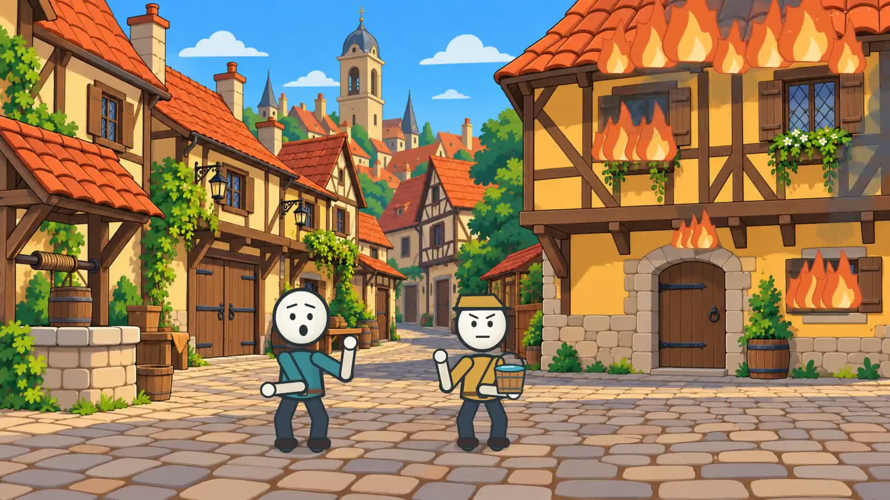

# Как люди тушили пожары до пожарных машин?

История в Палочках · полный фильм · **28:17.436735 · 1920×1080 · 16:9 · 25 fps**

## Finished video

[Download the complete MP4](https://raw.githubusercontent.com/voviethungit/hyperframes-studio/main/videos/firefighting-before-engines/firefighting-before-engines-complete.mp4)

The supplied Russian MP3 remains the final narration. No new voice, re-recording, speed adjustment, dialogue, lip sync, automatic subtitles, music or SFX were added. Encoded narration packet payload and decoded PCM were both verified identical to the source. Final visual coverage begins at zero and ends at the original MP3 container endpoint.

## Scene manifest

[CSV](https://raw.githubusercontent.com/voviethungit/hyperframes-studio/main/videos/firefighting-before-engines/scene-manifest.csv) · [JSON](https://raw.githubusercontent.com/voviethungit/hyperframes-studio/main/videos/firefighting-before-engines/scene-manifest.json)

256 manually authored semantic shots, aligned to 568 Russian script phrases and 3,645 spoken words with a Russian acoustic CTC model. The scene boundaries follow ideas and actions, not fixed-length blocks.

## QA report

[Readable report](qa-report.md) · [Machine-readable report](https://raw.githubusercontent.com/voviethungit/hyperframes-studio/main/videos/firefighting-before-engines/qa-report.json)

Every scene composition was inspected; motion was sampled within every scene and key mechanisms received additional phase checks. The entire exported file was decoded and checked for black intervals. A continuous real-time human viewing was not performed. See the QA report for the exact review scope and alignment limits.

## Production source

[Download animation source](https://raw.githubusercontent.com/voviethungit/hyperframes-studio/main/videos/firefighting-before-engines/firefighting-animation-source.zip) · [Reproduction instructions](REPRODUCE.md) · [Art direction](DESIGN.md)

This is an original locally animated Canvas2D film with 13 generated cartoon environment assets, assembled with FFmpeg/PyAV. Authenticated HeyGen motion generation was unavailable and was not used. The source archive excludes the standalone narration recording, uploaded reference videos and speech-model weights. No cloud-generated motion clip identifiers are invented; manifest asset IDs identify the local animation scenes.

SHA256 of final MP4: `2ab462f1d5c38f7278a757b5a9e32eea9cdbbc7a9bcfab6dedf9aecf4e3d57a0`
